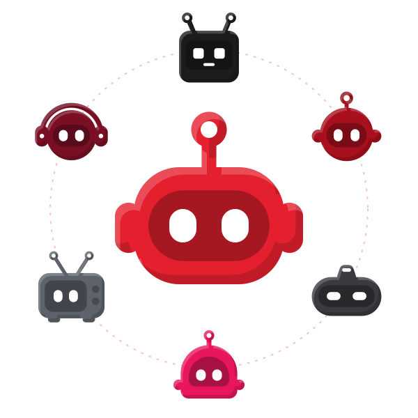

  <picture>
    <source media="(prefers-color-scheme: dark)" srcset="docs/images/logo-dark.svg">
    
  </picture>

# ApmixBot

 

ApmixBot is a team of AI bots: you create your own bots, then talk and work with them. It runs as a desktop app for Windows and macOS, or in Docker on a server or NAS. It works with any OpenAI- or Anthropic-compatible model API: you enter the endpoint and the API key in the app.

## Install

**Desktop app (Windows, macOS)**

Download ApmixBot from the [latest release](../../releases/latest):

- Windows (x64): `ApmixBot-<version>-win-x64.exe`. Run it; it installs for your user only, without administrator rights, and puts ApmixBot on the desktop.
- macOS: `ApmixBot-<version>-mac-arm64.zip` for an Apple chip, `ApmixBot-<version>-mac-x64.zip` for Intel. Unzip it, drag **ApmixBot** into **Applications** and open it.

The app is not signed with a developer certificate, so the system can warn at the first start:

- Windows: if Windows shows "Windows protected your PC", select **More info** → **Run anyway**.
- macOS: when macOS says it cannot check the app, open **System Settings** → **Privacy & Security** and select **Open Anyway**.

At the first start the app asks where to keep its data and the Bots' files (by default `~/.apmixbot` and `~/ApmixBot`). Then Chief, the main bot, asks for your model provider: the endpoint of any OpenAI- or Anthropic-compatible API, and its API key.

The app follows new releases by itself. On Windows it downloads a new version in the background and asks whether to restart now; otherwise the update is installed when you quit. On macOS it tells you about a new version and opens its download page. You can also install a new version by hand the same way as the first one: on Windows, run the new setup over the old one. Your data stays where it is.

**Docker (Linux, NAS, server)**

There is no desktop app for Linux. The [`docker/`](docker/) directory builds an image with ApmixBot's web interface, for a Linux machine, a NAS or any always-on machine. From the repository root, `docker compose up -d --build` builds the image on your machine and starts it. The container is the Bots' sandbox: they get full access to what you mount into it, and nothing else. See [`docker/README.md`](docker/README.md).

**From source**

With Node.js 24 and npm, install the workspace once from the repository root with `npm ci`, then run `npm run dist` in `app/`. The result is in `app/dist-pack/`. Build each one on the system it is for: the Windows installer on Windows, the arm64 zip on a Mac with an Apple chip, the x64 zip on an Intel Mac. See [`app/README.md`](app/README.md) for details.

## Setup

Set up your other bots and group chats by talking to a bot: Chief walks you through it.

## Features

### Bot

You can do all your talking and work with one bot, in one window, without worrying about the context behind it. The bot's details page shows its info, and there you pick the model it uses. You can switch models at any time; keeping one model per bot for a long time works best.

Bots also have memory. A bot remembers what you like and uses it in later work. You can manage its memory on the bot's details page, or just tell the bot.

### Main bot

The main bot is your chief. It has the highest rights: it manages the other bots and the group chats. The first time you open ApmixBot, there is already a main bot called Chief. Talk to it, and it walks you through the setup.

In short: have a question? Ask the main bot.

### Group chats

A group chat gets several bots to work together, at a higher cost. So every group chat has an admin: it answers your messages by default and calls in the other bots for you. You can also @ a bot directly: type @ and pick the bot from the list. To give the bots another chat as context, use + → Reference a chat in the message box.

Any bot can hand work to another bot with @. That bot does the work on its own, and the group goes on. While it works, it keeps the group posted, and the group, the sidebar and its own chat show what it is doing. When it is done, it posts the result in the group, and the bot that asked for the work answers. To stop the work, open the group's details.

A group chat has its own memory. What you tell the group stays in the group: its members use it there, and your other chats and the bots outside the group do not see it. You can manage it in the group's details.

### Models

ApmixBot is not tied to one model provider. The first time you open it, Chief's chat asks for a provider: the endpoint of any OpenAI- or Anthropic-compatible API (OpenAI, Anthropic, OpenRouter, a local server, and so on) and its API key. In **Settings** → **Models**, add more providers, fetch the models each one serves and pick the ones you need. Each bot then runs on the model you pick for it, in its details; models whose provider has no key are not offered. The keys stay in a credential store on your machine and are never shown again.

### Look

The bots are robot mascots in black, white and red. The default theme, ApmixBot, is black and white with a red accent. In **Settings** → **General**, you can pick another theme, an accent color and the bot animation (quiet, normal or lively). In a bot's settings, you can pick its character and color, or use your own photo.

### Capabilities

Settings → **Capabilities** is a shared library of MCP servers, skills and packs. Add a capability to a Bot in its settings; it is available from that Bot's next message in its own chat and group chats. A local MCP command that a Bot adds needs your approval before it can run. While other Bots use a capability, only you or a Main Bot can change or delete it.

### Usage

In **Settings** → **Usage**, you can see token usage by time, by bot and by model.

## Data

All data stays on your own computer: the desktop app keeps it in its data folder (`~/.apmixbot` by default), the Docker image in its `/data` volume. Uninstalling the app does not delete this data.

ApmixBot has no account and sends no telemetry or usage data. Your messages go only to the model provider you connect.

## Development

The repository is one npm workspace:

| Folder | What it is |
| --- | --- |
| [`engine/`](engine/) | The agent engine: sessions, tools, model routes and the web interface, as `@apmixbot/*` packages. |
| [`plugin/`](plugin/) | The Bot team, written as an engine plugin (package `apmixbot`). |
| [`app/`](app/) | The desktop app for Windows and macOS. |
| [`docker/`](docker/) | The Docker image. |

For the plugin's options and internals, see [`plugin/README.md`](plugin/README.md); for the app, see [`app/README.md`](app/README.md). For development, tests and how the team works, see [CONTRIBUTING.md](CONTRIBUTING.md). For changes between versions, see [CHANGELOG.md](CHANGELOG.md).

## Acknowledgments

- [esbuild](https://esbuild.github.io/): bundles the plugin's interface code.
- Thanks to these projects for the ideas they published. ApmixBot learned from their designs and does not contain their code:
  - [AgentMemoryRepo](https://github.com/AgentMemoryRepo/agentmemoryrepo): the Markdown format of Bot memory.
  - [OpenAI Codex](https://github.com/openai/codex): checkpoints that keep the user's messages next to the summary, and message anchors for chat search.
  - [OpenMausBot](https://github.com/milind-soni/OpenMausBot): group chat rounds and @mention relays.
  - [Hermes Agent](https://github.com/NousResearch/hermes-agent) and [Hermes Bot Mode](https://github.com/NousResearch/Hermes-Bot-Mode): one session per member per group chat, and handoffs that carry the earlier user messages.
  - [OpenCode](https://github.com/sst/opencode), [goose](https://github.com/block/goose), [pi](https://github.com/badlogic/pi-mono) and [Gemini CLI](https://github.com/google-gemini/gemini-cli): when to condense a long chat, and what a handoff note holds.
  - [obelisk](https://github.com/tommy0103/obelisk): chat search with a SQLite full-text index.

## License

[Apache License 2.0](LICENSE). Provided "as is", without any warranty. The notices of the work ApmixBot builds on are in [NOTICE](NOTICE), and the licenses of the engine's packages in [engine/LICENSE](engine/LICENSE).

## Disclaimer

Bots use your own model quota, and they read and write files and run commands when you ask them to. Check important actions yourself.
